<div align="center">

# Hyprland Dotfiles · Arch Linux

**Hyprland en config Lua + Quick-Bar, un shell Quickshell fait maison :
barre, dashboard, écran tactile, écrans de session, vue d'ensemble, sélecteurs de fonds.**
Tout se re-teinte avec **wallust** à chaque changement de fond d'écran.

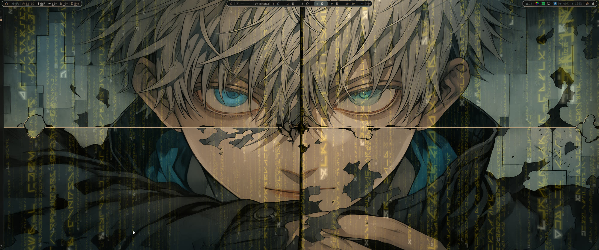

<sub>Écran principal 3440×1440 · fond animé (rafale du shader Matrix) · Quick-Bar en haut · Corsair Xeneon Edge 2560×720 en dessous</sub>

</div>

---

## Sommaire

- [Quick-Bar en bref](#quick-bar-en-bref)
- [Raccourcis clavier](#raccourcis-clavier)
- [La barre](#la-barre)
- [Écran de session](#écran-de-session--ctrlaltp)
- [Vue d'ensemble des espaces](#vue-densemble-des-espaces--supera)
- [Fonds d'écran et shaders](#fonds-décran-et-shaders--superw--altw)
- [Dashboard, Spotify, Réglages](#dashboard-spotify-réglages)
- [Panneau tactile Xeneon Edge](#panneau-tactile--corsair-xeneon-edge)
- [Mode jeu automatique](#mode-jeu-automatique)
- [Wallust et thèmes](#wallust--thèmes-dynamiques)
- [Game Launcher](#game-launcher--quickshell)
- [Configs incluses](#configs-incluses)
- [Installation](#installation)

---

## Quick-Bar en bref

Quick-Bar (`~/.config/quickshell/Quick-Bar`) remplace waybar, wlogout, le sélecteur de fonds rofi
et le plugin d'overview. Tout est en QML (Quickshell 0.3), toutes les couleurs viennent de la
palette wallust, et toutes les animations suivent une seule vitesse réglable.

| | |
|---|---|
| **Barre** | En haut, en bas, à gauche ou à droite · 1, 2 ou 3 îlots · tailles proportionnelles à la hauteur · modules à réordonner, masquer, régler |
| **Survols système** | Une carte détaillée au survol de chaque module (CPU, RAM, GPU, températures, disques, réseau) |
| **Écran de session** | 5 styles plein écran : Matrix, Netrunner, Jarvis, Minimal, Carte |
| **Vue d'ensemble** | Carrousel vertical des espaces façon niri, aperçus live, glisser-déposer |
| **Fonds d'écran** | Carrousel (SUPER+W), mode Cinéma (ALT+W), un fond par espace, 7 shaders animés |
| **Réglages** | Fenêtre flottante de 20+ onglets, tout s'applique en direct (`config.toml`) |
| **Panneau tactile** | Un clone à onglets du dashboard sur le Corsair Xeneon Edge |
| **Mode jeu** | Page dédiée, EQ, LED RGB et fond aux couleurs du jeu, puis tout revient à la sortie |

> La carte complète du projet (dossiers, flux, comment ajouter un onglet, un shader, un widget)
> est dans [`docs/ARCHITECTURE.md`](.config/quickshell/Quick-Bar/docs/ARCHITECTURE.md).

---

## Raccourcis clavier

Générés dans `Quick-Bar/hypr/quickbar.lua` (chargé par `hyprland.lua`), modifiables dans
**Réglages › Avancé › Raccourcis** (avec détection des conflits Hyprland).

| Raccourci | Action |
|---|---|
| `SUPER` `A` | Vue d'ensemble des espaces |
| `CTRL` `ALT` `P` | Écran de session |
| `SUPER` `W` | Fonds d'écran : carrousel |
| `ALT` `W` | Fonds d'écran : mode Cinéma |
| `CTRL` `ALT` `W` | Fond d'écran au hasard |
| `SUPER` `SHIFT` `D` | Dashboard |
| `SUPER` `SHIFT` `S` | Panneau Spotify |
| `SUPER` `F1` | Réglages |
| `SUPER` `T` | Pause tactile en jeu (libère le curseur pour l'écran tactile, retour auto au jeu) |
| `SUPER` `F2` | Mode focus |
| `ALT` `F9` | Capture vidéo |

Tout se pilote aussi en ligne de commande : `qs -p ~/.config/quickshell/Quick-Bar/shell.qml ipc call <cible> <fonction>`
(`overview toggle`, `session open`, `settings open theme`, `touch page grid`, `wallpicker random`…).

---

## La barre

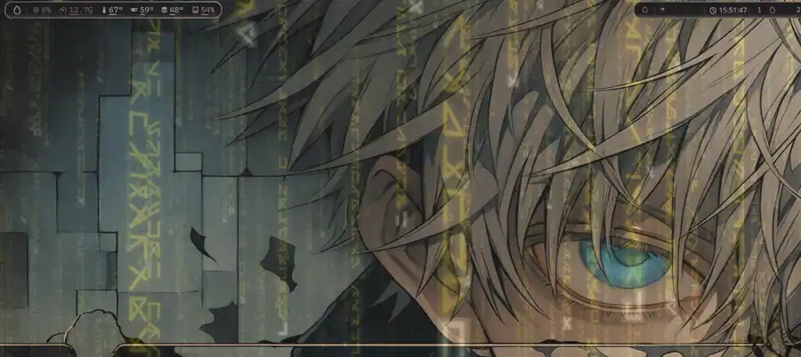

- Chaque module système ouvre une **carte au survol** : courbe, détail, plus gros consommateurs,
  disques et ce qu'on peut libérer (corbeille, cache pacman). Clic droit : actions.
- **Position** haut / bas / gauche / droite, **1, 2 ou 3 îlots**, icônes et texte à l'échelle de
  l'épaisseur, arrondi plafonné pour rester propre.
- Modules : espaces de travail, horloge, Cava (ouvre le dashboard), lecteur, réseau, Bluetooth,
  volume, luminosité, notifications, plateau, capture, session…

---

## Écran de session · `CTRL`+`ALT`+`P`

Cinq styles au choix dans **Réglages › Panneaux › Écran de session**, tous en plein écran.
Même clavier partout : `←` `→` pour choisir, `Entrée` pour valider, les lettres `L` `U` `E` `R` `S` `B`
en direct, `Échap` pour fermer. Déconnexion, redémarrage, arrêt et BIOS passent par un compte à
rebours de 3 secondes, qu'on annule avec `Échap` ou un clic.

<table>
<tr>
<td width="50%" valign="top">

**Matrix**
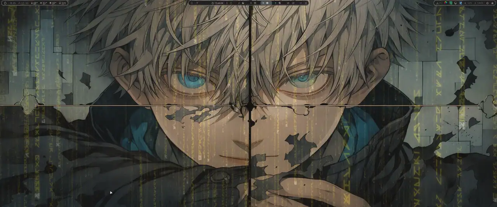
Plongée dans la pluie (le shader du fond animé, ton fond deviné dessous), terminal qui s'allume
comme un écran cathodique, frappe ligne par ligne, ligne choisie qui se « déchiffre ». Pendant le
compte à rebours, la pluie accélère et change de couleur.

</td>
<td width="50%" valign="top">

**Netrunner · Breach Protocol**
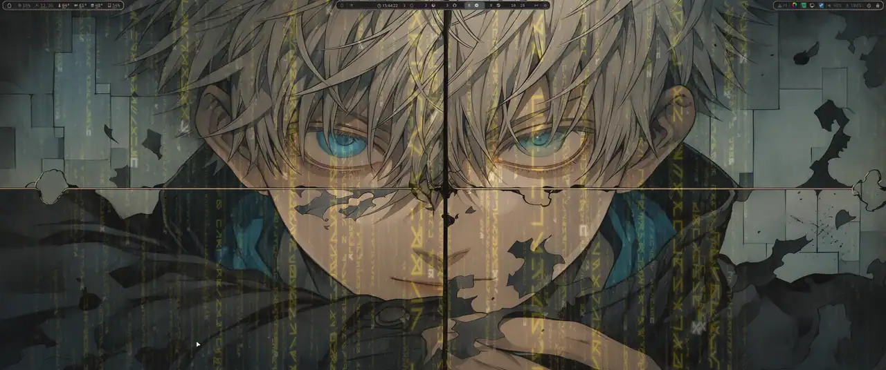
Le mini-jeu de piratage de Cyberpunk 2077. Chaque action est un *daemon* avec sa séquence de codes ;
valider lance la brèche, le curseur suit le chemin dans la matrice et remplit le buffer. La RAM du
« cyberdeck » est ta vraie RAM, la *trace* ton CPU.

</td>
</tr>
<tr>
<td valign="top">

**Jarvis**
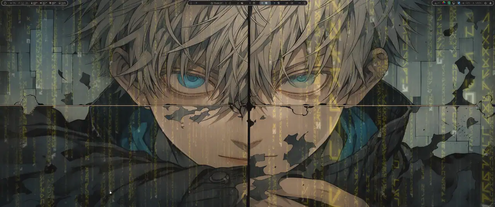
HUD holographique : réacteur dont les anneaux se tracent puis tournent, actions en secteurs,
ligne de rappel vers la fiche de l'action, diagnostic système, radar réseau et journal dans les coins.

</td>
<td valign="top">

**Minimal**
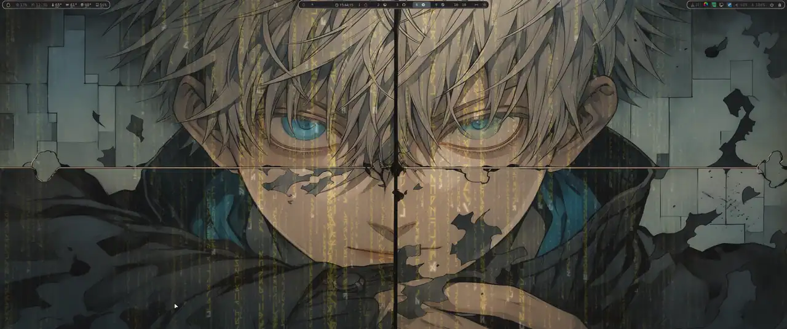
Fond flouté, grande heure aux chiffres qui roulent, trait des secondes, six mots et un
soulignement élastique. Pendant le compte à rebours, l'heure laisse place à un grand 3, 2, 1.

</td>
</tr>
</table>

Fichiers : `panels/SessionPanel.qml` (logique commune) + `SessionMatrix.qml`, `SessionCyber.qml`,
`SessionJarvis.qml`, `SessionMinimal.qml`.

---

## Vue d'ensemble des espaces · `SUPER`+`A`

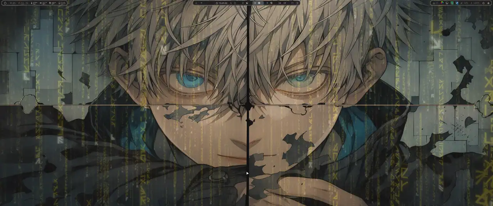

Remplace le plugin `hyprland-scroll-overview`, sur la même idée (une colonne d'espaces, comme
niri), mais animée : le bureau rétrécit en carte, les autres espaces glissent autour, et on
replonge dans l'espace choisi en sortant.

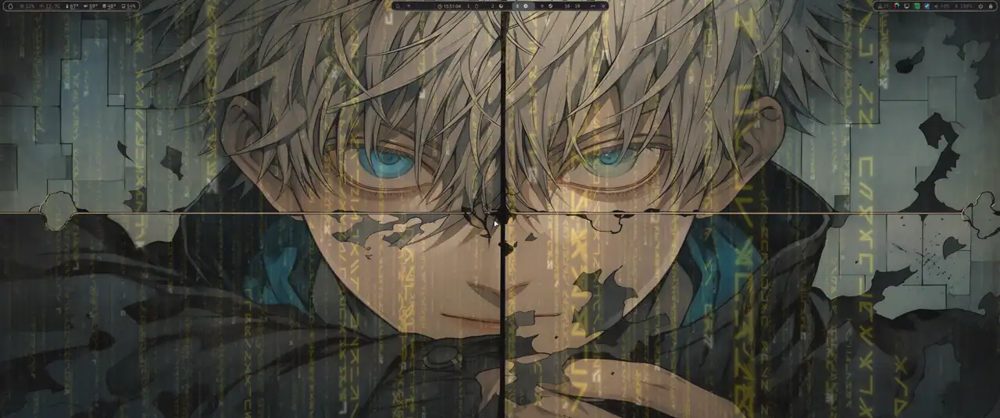

- `↑` `↓` ou molette : changer d'espace · `←` `→` : changer de fenêtre · `1`–`9` : sauter
- Survol d'une carte : elle se soulève et propose « Aller sur l'espace N » · un clic y va
- **Glisser une fenêtre** : une vignette live suit le curseur, la carte visée s'allume, le bandeau
  défile seul près des bords ; lâchée dans le vide, elle revient à sa place
- `X` ou clic molette : fermer · `Maj`+`↑` `↓` : déplacer · carte **+** : nouvel espace
- `−` `+` : taille des cartes · `H` : halo sur la fenêtre active (les deux sont mémorisés)

---

## Fonds d'écran et shaders · `SUPER`+`W` · `ALT`+`W`

<table>
<tr>
<td width="50%" valign="top">

**Carrousel (SUPER+W)**
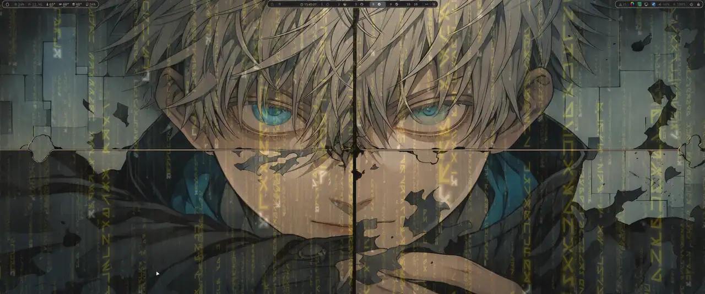
Coverflow avec halo, aperçu de la palette, *Au hasard*, *Un fond par espace* (et recoloration de
tout le système à chaque changement d'espace).

</td>
<td width="50%" valign="top">

**Cinéma (ALT+W)**
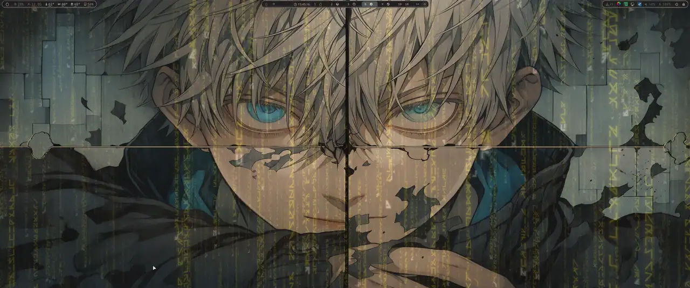
Plein écran, bande de vignettes en arc, la carte choisie grossit avec son halo.

</td>
</tr>
</table>

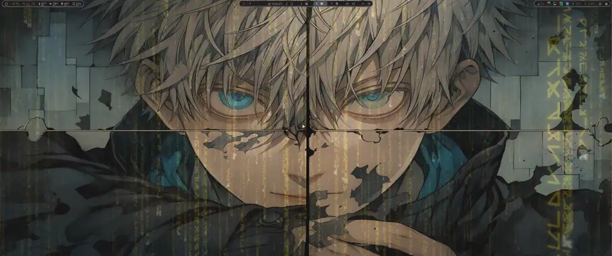

**Fonds animés** : des shaders portés depuis kitty jouent par rafales (ou en continu) sur le fond :
*Matrix*, *Aurora*, *Underwater*, *Fireworks*, *Cyberpunk*, *Braindance*, *Neon*, plus un effet au
changement d'espace. Intensité, fréquence, durée et vitesse se règlent, la couleur suit l'accent
wallust. Les **vidéos** en fond sont gérées aussi (la palette suit la vidéo).

---

## Dashboard, Spotify, Réglages


Le **dashboard** s'ouvre depuis le module Cava ou `SUPER`+`SHIFT`+`D` : profil, calendrier,
horloge / minuteur / alarme / chrono, lecteur, réglages rapides (écran, tactile, Wi-Fi, Bluetooth,
caféine, focus, ne pas déranger, capture, filtre).

<div align="center">
  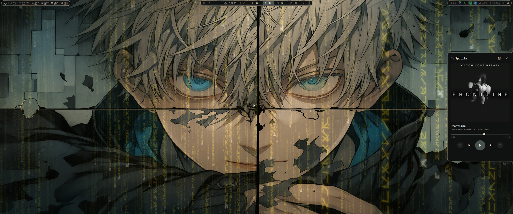
</div>

Le **panneau Spotify** (`SUPER`+`SHIFT`+`S`) s'ouvre toujours du côté opposé à la barre.

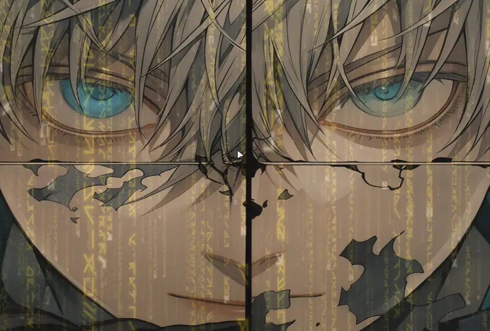

Les **Réglages** sont une fenêtre flottante (le bureau reste utilisable derrière) : thème,
couleurs, police, **thème d'icônes**, animations (vitesse + 12 transitions d'onglets avec aperçu),
barre et modules, rafraîchissement, dashboard, panneau tactile, apps, Spotify, écran de session,
notifications, fonds, audio et EQ, capture, mode jeu, stats et seuils d'alerte, santé,
dépendances, raccourcis, données. Chaque bloc a son bouton *Par défaut*, la recherche trouve
n'importe quel réglage, l'onglet ouvert est retenu.

---

## Panneau tactile · Corsair Xeneon Edge

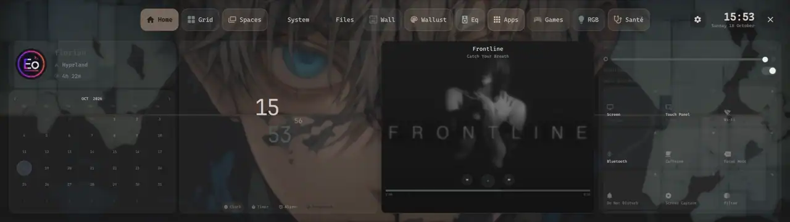

Plein écran sur le tactile (détecté par modèle), un clone tactile du dashboard organisé en onglets.

<table>
<tr>
<td width="50%">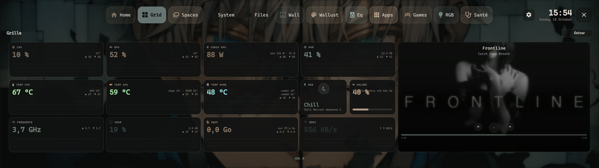<br><b>Grid</b> · widgets libres façon Nothing, cartes système avec courbes</td>
<td width="50%">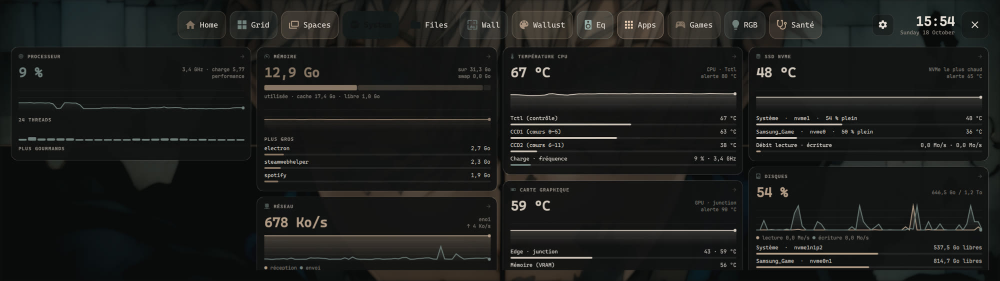<br><b>System</b> · les mêmes cartes que les survols de la barre</td>
</tr>
<tr>
<td>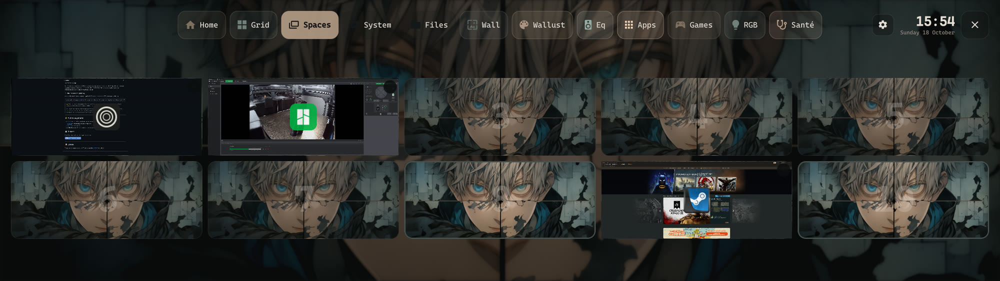<br><b>Spaces</b> · espaces avec aperçus live, glisser une fenêtre au doigt</td>
<td>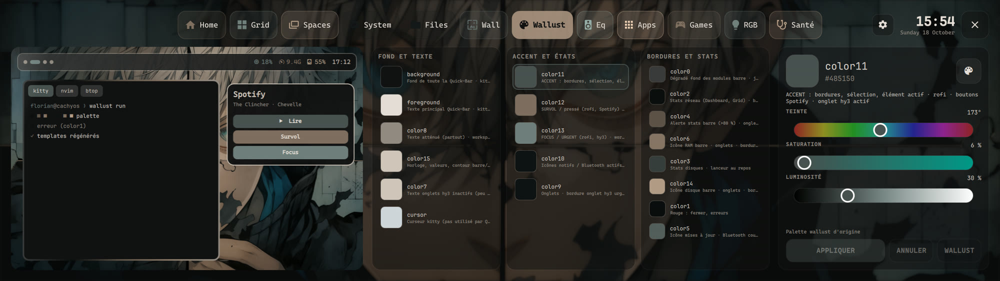<br><b>Wallust</b> · éditer la palette, aperçu en direct, rôle de chaque couleur</td>
</tr>
<tr>
<td>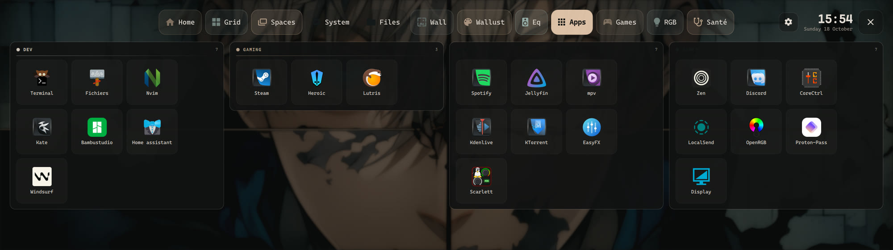<br><b>Apps</b> · lanceurs façon Stream Deck, vrais logos, sections colorées</td>
<td>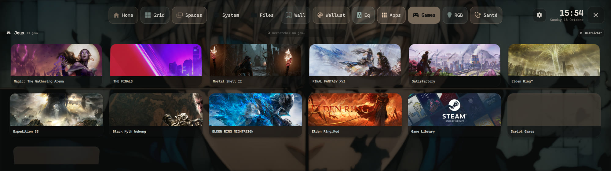<br><b>Games</b> · jaquettes Steam et jeux manuels, lancement au tap</td>
</tr>
<tr>
<td>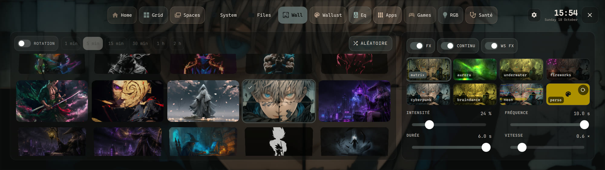<br><b>Wall</b> · fonds, rotation automatique, réglages des shaders</td>
<td>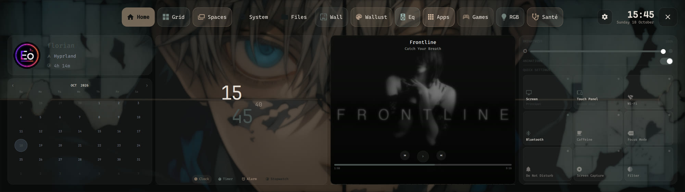<br><b>Home</b> · profil, calendrier, horloge, lecteur, réglages rapides</td>
</tr>
</table>

Et aussi : **Game** (apparaît seul en jeu), **Files** (explorateur type yazi), **Eq** et **Mixer**
(égaliseur 10 bandes, presets, volume par application), **Discord** (chat deux sens via un bot,
clavier virtuel), **RGB** (modes OpenRGB), **Santé** (bilan de la machine et des services,
vérifications perso cliquables).

- Onglets à activer, réordonner et zoomer un par un (⚙ ou Réglages)
- 12 transitions au choix : Goutte, Bulle, Iris, Rebond, Carte, Tourbillon, Rideau, Zoom…
- Onglets chargés à l'ouverture puis libérés : la RAM reste basse
- Les apps lancées depuis le tactile s'ouvrent sur l'écran principal, sans voler le curseur

<details>
<summary><b>Onglet Apps : format de <code>user_data/streamdeck.json</code></b></summary>

```json
[
  {
    "title": "Dev",
    "accent": 4,
    "items": [
      { "icon": "󰅩", "appicon": "windsurf", "label": "Windsurf", "exec": "windsurf" },
      { "icon": "", "appicon": "/usr/share/pixmaps/kitty.png", "label": "Nvim", "exec": "kitty -e nvim" }
    ]
  }
]
```

`appicon` = nom d'icône ou chemin absolu · `icon` = glyphe Nerd Font de secours ·
`accent` = index de la palette wallust · app terminale : `"exec": "kitty -e nvim"`.
Se modifie aussi depuis **Réglages › Panneaux › Apps**.

</details>

<details>
<summary><b>Onglet Discord : prérequis</b></summary>

Un bot avec l'intent **Message Content**, présent dans le serveur, et son token dans
`~/.config/quickshell/Quick-Bar/.discord_token` (jamais poussé). Historique, messages en direct,
threads, embeds et boutons rendus, téléchargements via qBittorrent.

</details>

---

## Mode jeu automatique

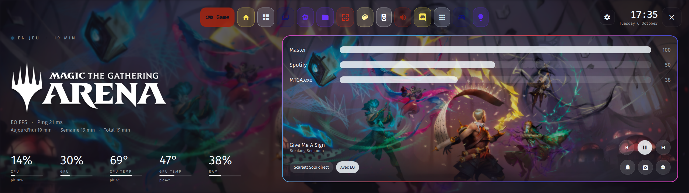

Dès qu'une fenêtre de jeu s'ouvre (tag Hyprland `games`, posé par `configs lua/WindowRulesGaming.lua`
sur `steam_app_*`, gamescope, `*.exe`) :

- le panneau tactile bascule sur **Game** : logo et bannière Steam (retrouvés aussi par l'appid du
  processus et le CDN Steam), mesures avec pics de session, ping, temps de jeu ;
- les **couleurs du jeu** passent sur le contour, le fond et les **LED OpenRGB** ;
- l'**égaliseur** passe sur le preset FPS du casque en cours ;
- *Ne pas déranger*, capture, enregistrement et **pause tactile** (`SUPER`+`T`) sont à portée de doigt ;
- à la fermeture, **tout revient comme avant**, même après un redémarrage de Quickshell.

Les logiciels Windows qui ne sont pas des jeux (Fusion 360…) s'excluent dans **Réglages › Jeu**.

---

## Wallust · thèmes dynamiques

Wallust extrait une palette du fond d'écran et la pousse partout : Quick-Bar, Hyprland, kitty,
rofi, swaync, GTK (thème basé sur [phocus/gtk](https://github.com/phocus/gtk)), Spotify
(spicetify), Discord, Zen, starship, cava.

<div align="center">
  
</div>
<div align="center">
  
  
</div>

---

## Game Launcher · Quickshell

Lanceur de jeux maison : mode fenêtré et mode plein écran façon console (**Big Mode**), jaquettes
récupérées automatiquement (Steam, jeux manuels, SteamGridDB), options par jeu.

<div align="center">
  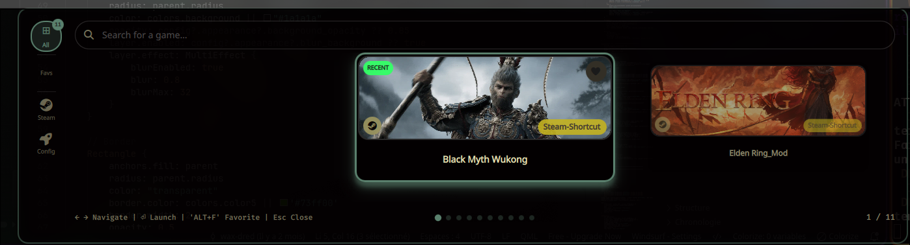
  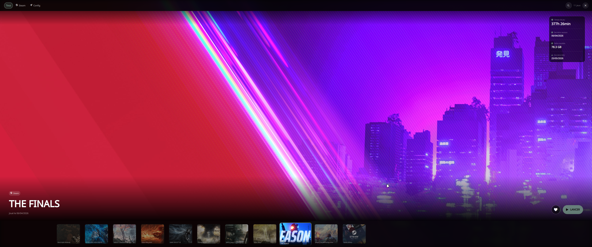
</div>

<details>
<summary><b>Scripts de lancement par jeu (gamescope, MangoHud, FSR…)</b></summary>

Les scripts sont dans `~/.config/hypr/scripts/GameScripts/` (`add-script.sh` pour en créer un,
`new-game` comme modèle). Exemple :

```bash
GAMESCOPE_OPTIONS="False"
GAME_PERF="True"
GAME_VRR="True"
MANGOHUD_OPTION="True"
OPTION_AFTER="-useallavailablecores"

MONITOR="DP-1"
RESOLUTION="3440x1440"
REFRESH_RATE="165"
FSR="True"
```

Dans Steam, options de lancement : `The_Finals %command%`.

</details>

---

## Configs incluses

```
.config/
├── hypr          Hyprland en Lua (configs lua/, scripts/, GameScripts/, wallust/)
├── quickshell    Quick-Bar · game-launcher · overview · hyprquickpaper
├── wallust       palette dynamique + templates (kitty, discord, zen, starship…)
├── kitty · fish · starship.toml · nvim · zed
├── rofi (+ rofi-game-launcher, rofi-games, rofi-spotify)
├── swaync · cava · mpv · fastfetch · btop · yazi · ranger
├── pypr · spicetify · MangoHud · vader5
├── gtk-3.0 · gtk-4.0 · qt5ct · qt6ct · Kvantum · nwg-look · nwg-displays
└── …
```

Aussi : `home_dotfiles/` (`.zshrc`, `.bashrc`), `.themes/gtk`, `Pictures/wallpapers`, profil `.zen`,
thème SDDM `simple-sddm-2/`.

**Tenir la sauvegarde à jour** : `./sync.sh` montre ce qui a changé dans `~/.config`,
`./sync.sh --go` recopie (sans secrets, caches, journaux ni `.bak`) et vérifie qu'aucun secret ne
part, puis `git commit` et `git push`.

---

## Installation

> Arch Linux uniquement. Lance le script en utilisateur normal, `sudo` est demandé au besoin.

```bash
git clone https://github.com/Eaquo/Hyprland-Dotfiles-Arch-linux.git hypr-restore
cd hypr-restore
./install.sh
```

Le script est interactif : chaque grande étape demande confirmation.

| # | Étape | Détail |
|---|---|---|
| 1 | Vérifications | Arch, non-root, sudo, réseau |
| 2 | **yay** | installé s'il manque |
| 3 | Paquets officiels | `pkglist-pacman.txt` |
| 4 | Paquets AUR | `pkglist-aur.txt` (quickshell, wallust, pyprland, spicetify…) |
| 5 | Dotfiles | `~` et `~/.config`, question à part pour les fonds (`Pictures`) |
| 6 | Shell | fish ou zsh |
| 7 | Plugins **hyprpm** | hy3 |
| 8 | Thème **SDDM** | `simple-sddm-2` + session Hyprland |
| 9 | Services | NetworkManager, bluetooth, SDDM, puis redémarrage |

Fichiers existants : `[o]` tout écraser (l'ancien est gardé en `<nom>_backup`), `[g]` garder
l'existant, `[d]` demander à chaque fois. Un paquet qui échoue n'arrête pas le script : il est
noté dans `~/hypr-install.log`.

Dans Quick-Bar, **Réglages › Système › Dépendances** liste ce qui manque (logiciels, polices,
modules Python) et donne la commande d'installation.

### Plugins Hyprland

Seul **hy3** est encore utilisé (la vue d'ensemble est maintenant dans Quick-Bar). À lancer dans
une session Hyprland :

```bash
hyprpm update && hyprpm enable hy3 && hyprpm reload
```

> Ne lance jamais `sudo hyprpm` : le cache passe à root et les plugins sautent à chaque mise à
> jour (réparer : `sudo chown -R $USER:$USER /var/cache/hyprpm/$USER`). Si hy3 a été compilé pour
> une autre version de Hyprland, recompile-le avec `~/.config/hypr/scripts/rebuild-hy3.sh`, puis
> `hyprpm disable hy3` et reconnecte-toi.

### Après un clone : secrets à recréer

Ces fichiers ne sont jamais publiés. `user_data/` (réglages perso) se recrée au premier
lancement ; les deux fichiers ci-dessous servent à l'onglet Discord.

```bash
echo "TON_TOKEN_BOT" > ~/.config/quickshell/Quick-Bar/.discord_token
echo "TON_SECRET"    > ~/.config/quickshell/Quick-Bar/.dl_secret
chmod 600 ~/.config/quickshell/Quick-Bar/.discord_token ~/.config/quickshell/Quick-Bar/.dl_secret
```

---

## Remerciements

- [JaKooLit](https://github.com/JaKooLit), qui m'a fait découvrir et aimer Hyprland
- [Hyprland](https://github.com/hyprwm/Hyprland) et [Quickshell](https://quickshell.org)
- [yayuuu/hyprland-scroll-overview](https://github.com/yayuuu/hyprland-scroll-overview), l'inspiration de la vue d'ensemble
- Les shaders d'origine sur Shadertoy (*Inside the Matrix* et les autres, crédités dans chaque `.frag`)
- [r/unixporn](https://reddit.com/r/unixporn)

## Soutien

Si ce projet te plaît, tu peux m'offrir un café :

[](https://ko-fi.com/waxdred)

## Licence

MIT.
